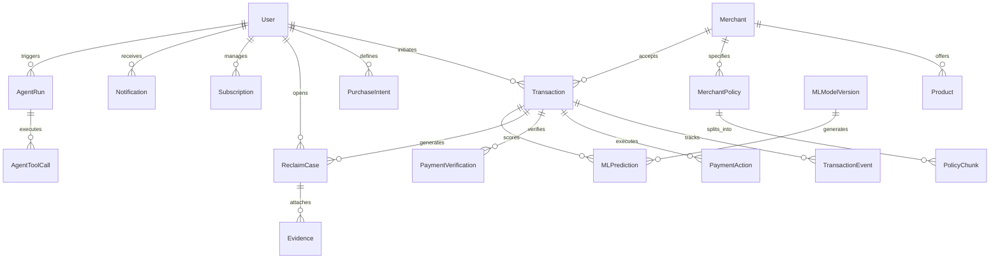

# PayPath Data Architecture & PostgreSQL Schema Specification

## 1. Executive Summary

PayPath uses **PostgreSQL 16** as its single, authoritative system of record. All domain entities, financial transactions, idempotent execution keys, audit logs, vector embeddings, ML model registry records, and multi-agent execution spans are unified and stored in PostgreSQL.

---

## 2. Entity-Relationship Diagram (ERD)

---

## 3. Database Table Catalog (20 Application Domain Tables + 1 Alembic Metadata Table = 21 Authoritative Tables)

### 3.1 Identity & Access Management
1. **`users`**
   - Core identity entity supporting Role-Based Access Control (`USER`, `MERCHANT_ADMIN`, `PLATFORM_ADMIN`).
   - Fields: `id`, `email`, `full_name`, `hashed_password`, `role`, `is_active`, `mfa_enabled`, `mfa_secret`, `created_at`, `updated_at`.
2. **`audit_logs`**
   - Immutable security and compliance event journal.
   - Fields: `id`, `user_id`, `action`, `resource_type`, `resource_id`, `ip_address`, `details`, `created_at`.

### 3.2 Merchant & Catalog Subsystem
3. **`merchants`**
   - Verified sellers and service providers.
   - Fields: `id`, `name`, `paypal_merchant_id`, `risk_tier`, `contact_email`, `status`, `meta_info`, `created_at`, `updated_at`.
4. **`products`**
   - Items available for agentic shopping and checkout.
   - Fields: `id`, `merchant_id`, `title`, `description`, `price`, `currency`, `category`, `in_stock`, `image_url`, `created_at`, `updated_at`.
5. **`merchant_policies`**
   - Structured policies for return, refund, replacement, and warranty.
   - Fields: `id`, `merchant_id`, `title`, `policy_type`, `raw_text`, `is_active`, `created_at`, `updated_at`.
6. **`policy_chunks`**
   - RAG vector embeddings and text chunks partitioned by tenant (merchant ID).
   - Fields: `id`, `policy_id`, `merchant_id`, `chunk_index`, `chunk_text`, `embedding_vector`, `meta_info`, `created_at`.

### 3.3 Transaction & Core Payment Subsystem
7. **`transactions`**
   - Master financial transaction record.
   - Fields: `id`, `user_id`, `merchant_id`, `merchant_name`, `paypal_order_id`, `paypal_capture_id`, `amount`, `currency`, `status`, `verification_status`, `risk_score`, `risk_level`, `ai_summary`, `item_description`, `meta_info`, `created_at`, `updated_at`.
8. **`transaction_events`**
   - Chronological event timeline for transaction monitoring.
   - Fields: `id`, `transaction_id`, `event_type`, `description`, `meta_info`, `created_at`.
9. **`purchase_intents`**
   - User purchasing goals parsed by NLP/Agentic layer.
   - Fields: `id`, `user_id`, `raw_prompt`, `category`, `purpose`, `budget_amount`, `currency`, `approval_required`, `autonomy_level`, `status`, `created_at`, `updated_at`.
10. **`payment_actions`**
    - Idempotency-keyed financial mutations (order creation, capture, refund).
    - Fields: `id`, `transaction_id`, `idempotency_key`, `action_type`, `amount`, `currency`, `status`, `actor_id`, `response_payload`, `created_at`.
11. **`payment_verifications`**
    - Dual-phase read-back verification results from PayPal gateway.
    - Fields: `id`, `transaction_id`, `payment_action_id`, `gateway_resource_id`, `status_match`, `amount_match`, `currency_match`, `is_verified`, `verification_badge`, `raw_gateway_response`, `created_at`.
12. **`subscriptions`**
    - Recurring payment profiles and interval spend limits.
    - Fields: `id`, `user_id`, `merchant_id`, `merchant_name`, `billing_interval`, `amount`, `currency`, `status`, `next_billing_at`, `created_at`, `updated_at`.

### 3.4 RECLAIM Dispute & Evidence Subsystem
13. **`reclaim_cases`**
    - Autonomous post-transaction disputes and recovery claims.
    - Fields: `id`, `transaction_id`, `user_id`, `merchant_id`, `issue_type`, `description`, `proposed_resolution`, `recommended_amount`, `confidence_score`, `requires_approval`, `approval_status`, `status`, `created_at`, `updated_at`.
14. **`evidence`**
    - Multi-modal evidence artifacts (photos, receipts, shipping labels) supporting claims.
    - Fields: `id`, `reclaim_case_id`, `file_name`, `file_path`, `mime_type`, `file_size_bytes`, `verified_magic_bytes`, `analysis_summary`, `created_at`.

### 3.5 Machine Learning & Analytics Subsystem
15. **`ml_model_versions`**
    - Registry for supervised and unsupervised models.
    - Fields: `id`, `model_name`, `algorithm`, `version`, `feature_version`, `training_dataset`, `trained_at`, `metrics`, `status`, `artifact_path`, `created_at`, `updated_at`.
16. **`ml_predictions`**
    - Audit log of inference predictions and feature contributions.
    - Fields: `id`, `transaction_id`, `model_version`, `risk_score`, `anomaly_score`, `prediction_label`, `feature_vector`, `feature_contributions`, `created_at`.

### 3.6 Multi-Agent Orchestration & Observability Subsystem
17. **`agent_runs`**
    - Execution traces of autonomous agents (Intent, Shopping, Guard, Reclaim, Recovery).
    - Fields: `id`, `agent_name`, `session_id`, `user_id`, `latency_ms`, `decision_summary`, `meta_info`, `created_at`.
18. **`agent_tool_calls`**
    - Discrete tool invocations within agent execution chains.
    - Fields: `id`, `agent_run_id`, `tool_name`, `tool_arguments`, `tool_result`, `latency_ms`, `status`, `created_at`.

### 3.7 Notifications & Alerts
19. **`notifications`**
    - High-priority transaction alerts, policy violations, and approval requests.
    - Fields: `id`, `user_id`, `type`, `title`, `message`, `is_read`, `action_url`, `created_at`.

### 3.8 Gateway Ingestion & Schema Migrations
20. **`webhook_events`**
    - Immutable event deduplication store for asynchronous gateway signals (e.g. PayPal Webhooks).
    - Prevents replay attacks via unique constraint on `paypal_event_id` and raw SHA-256 payload hashing.
    - Fields: `id`, `paypal_event_id`, `transmission_id`, `event_type`, `received_at`, `processed_at`, `status`, `payload_hash`, `processing_error`.
21. **`alembic_version`**
    - Authoritative database schema migration version tracking table.
    - Fields: `version_num`.

---

## 4. Migration & Zero-to-Head Integrity

Database migrations are managed via **Alembic** (`backend/alembic/`):
- Clean zero-to-head migration verified against raw PostgreSQL 16.
- Connection pooling configured via `asyncpg` with pre-ping validation, automated reconnects, and statement timeouts.
- All primary keys utilize robust UUIDv4 or deterministic semantic prefixes (`usr_`, `mch_`, `tx_`, `case_`, `prod_`).

