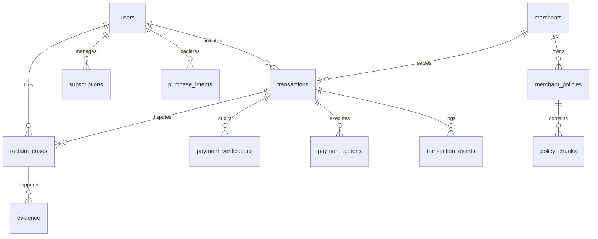

# PayPath Authoritative PostgreSQL Data Model

## Relational Architecture
PayPath enforces a relational data model with PostgreSQL 16 as the single source of truth.

## Core Entities & Fields

### 1. `users`
- `id` (VARCHAR(36), PK): UUID identifier.
- `email` (VARCHAR(255), UNIQUE, Indexed): Login identifier.
- `hashed_password` (VARCHAR(255)): Bcrypt salted hash.
- `role` (ENUM): `USER`, `MERCHANT_USER`, `MERCHANT_ADMIN`, `PLATFORM_ADMIN`.
- `mfa_enabled` (BOOLEAN): Two-factor TOTP flag.
- `mfa_secret` (VARCHAR(64)): Base32 encrypted TOTP secret.
- `password_reset_token` (VARCHAR(128)): SHA-256 hashed one-time token.
- `password_reset_expires` (TIMESTAMP WITH TIME ZONE): Expiration timestamp.

### 2. `merchants`
- `id` (VARCHAR(36), PK): UUID.
- `name` (VARCHAR(255)): Business legal name.
- `slug` (VARCHAR(100), UNIQUE): URL-safe merchant slug.
- `paypal_merchant_id` (VARCHAR(100)): PayPal partner account ID.
- `support_email` (VARCHAR(255)): Support endpoint.
- `is_verified` (BOOLEAN): Trust verification status.

### 3. `merchant_policies` & `policy_chunks`
- `merchant_policies`: Title, `policy_type` (`REFUND`, `RETURN`, `SPENDING`), raw text, version, `rules_json`.
- `policy_chunks`: Chunks with `merchant_id` tenant isolation, text content, and 128-dimensional embedding vector stored in JSON column with cosine indexing.

### 4. `transactions`
- `id` (VARCHAR(36), PK).
- `paypal_order_id`, `paypal_capture_id` (VARCHAR(100), Indexed).
- `amount` (NUMERIC(12,2)), `currency` (VARCHAR(3)).
- `status` (`CREATED`, `CAPTURED`, `REFUNDED`, `PARTIALLY_REFUNDED`, `FAILED`).
- `verification_status` (`PENDING`, `VERIFIED`, `MISMATCH`, `FAILED`).
- `risk_score` (NUMERIC(4,2)), `risk_level` (`LOW`, `MEDIUM`, `HIGH`).
- `ai_summary`, `item_description`.

### 5. `reclaim_cases` & `evidence`
- `reclaim_cases`: Linked transaction, issue type (`DAMAGED_ITEM`, `WRONG_ITEM`, `NOT_RECEIVED`, `DUPLICATE_CHARGE`), status, proposed resolution, recommended amount, confidence score, policy citation.
- `evidence`: File name, verified MIME type, URL, analysis summary, confidence score.

