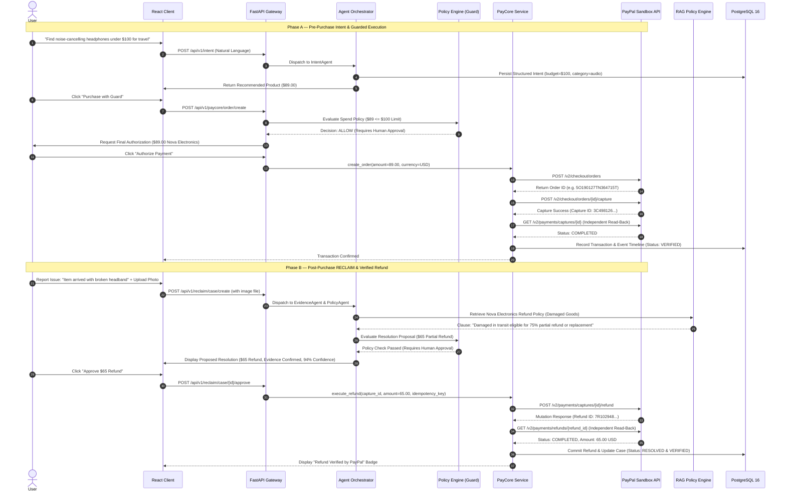

# PayPath — End-to-End Workflow Specifications

## 1. Hero Flow: From Intent to Verified Post-Purchase Resolution

---

## 2. Duplicate Charge Detection Flow
1. **Periodic / Ingestion Trigger:** Transaction event ingested.
2. **Deterministic Scan:** Query matches against `user_id`, `merchant_id`, `amount`, and `timestamp` within a 15-minute rolling window.
3. **Signal Generation:** If a matching transaction is found with matching external authorization characteristics, a `Potential Duplicate Signal` is generated.
4. **User Notification:** In-app alert prompts the user to review the suspected double billing.
5. **Human Control:** One-click review routes the user to RECLAIM with pre-filled duplicate evidence.

---

## 3. Policy Ingestion & Chunking Flow
1. **Merchant Upload:** Merchant uploads policy document (`.pdf`, `.md`, or `.txt`).
2. **Text Extraction:** Document parsed and normalized into structured markdown.
3. **Semantic Chunking:** Content segmented into clause-specific chunks (e.g. `Damaged Goods`, `Return Window`, `Restocking Fees`).
4. **Vector Embedding:** Chunk vectors generated via embedding provider and stored in PostgreSQL with metadata.
5. **Rule Extraction:** AI extracts candidate numerical rules (`refund_window_days: 30`, `max_auto_refund: 50.00`).
6. **Merchant Publishing:** Merchant reviews and publishes; only published versions are queried by active transactions.

