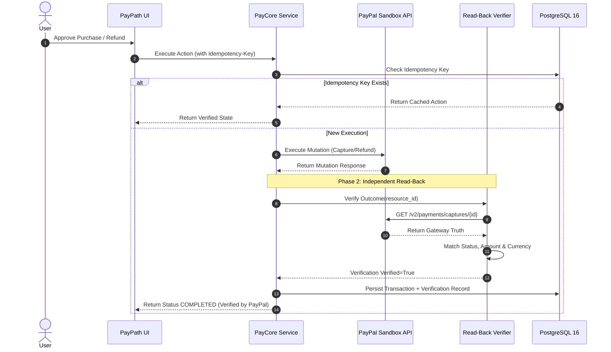

# PayPath Full-System Integration & Dual-Phase Verification

## 1. Vision & Architecture Philosophy

PayPath is an AI Transaction Intelligence, Agentic Commerce, and Payment Action Platform engineered around a foundational financial philosophy:

> **Understand. Decide. Act. Verify.**

Financial workflows must not execute solely on LLM decisions or hallucinated outputs. Instead:
1. **Understand**: User intent is parsed into structured parameters, contextualized with RAG merchant policies, and scored by a deterministic 12-feature ML model.
2. **Decide**: The deterministic **Policy Engine** evaluates the intent against user spend limits, merchant policies, and ML risk thresholds. Human-in-the-loop approval is mandatory for consequential actions.
3. **Act**: Consequential financial mutations (order creation, authorization, capture, refund) are executed against the PayPal Gateway using cryptographic idempotency keys.
4. **Verify**: PayPath executes an independent read-back query directly against PayPal's API to independently verify status, capture ID, currency, and amount before persisting the outcome.

---

## 2. End-to-End System Architecture

```text
       ┌────────────────────────┐
       │     REACT FRONTEND     │
       │  (Vite + TailwindCSS)  │
       └───────────┬────────────┘
                   │ HTTPS / JSON API
                   ▼
       ┌────────────────────────┐
       │     FASTAPI SERVER     │
       │      (Python 3.12)     │
       └─────┬───────┬────┬─────┘
             │       │    │
   ┌─────────┘       │    └─────────┐
   ▼                 ▼              ▼
┌──────────────┐ ┌──────────────┐ ┌──────────────────┐
│  PostgreSQL  │ │  ML Engine   │ │  Policy Engine   │
│ 16 Database  │ │(XGB + IF)    │ │(Deterministic)   │
└──────────────┘ └──────────────┘ └────────┬─────────┘
                                           │
                                           ▼
                                 ┌──────────────────┐
                                 │  PayPal Gateway  │
                                 │  (Idempotent)    │
                                 └─────────┬────────┘
                                           │
                                           ▼
                                 ┌──────────────────┐
                                 │ Dual-Phase Read- │
                                 │ Back Verifier    │
                                 └──────────────────┘
```

---

## 3. Dual-Phase Read-Back Verification Workflow

To eliminate desynchronization and prevent "phantom payments", PayPath enforces an independent verification loop:



---

## 4. Multi-Agent Collaboration Framework

PayPath employs a specialized multi-agent architecture with strict boundaries:

1. **Intent Agent**: Parses conversational user prompts into structured financial objectives (budget, category, merchant, constraints).
2. **Shopping Agent**: Evaluates merchant catalogs, compares pricing, and selects products aligned with intent.
3. **Guard Agent**: Pre-transaction compliance gatekeeper checking user velocity, category restrictions, and ML anomaly scores.
4. **Evidence Agent**: Analyzes uploaded dispute files (images, PDFs) with magic-byte verification and multi-modal issue diagnosis.
5. **Resolution Agent**: Proposes fair dispute settlements by retrieving merchant policies via tenant-isolated RAG.

---

## 5. Security & Invariant Hardening

- **PostgreSQL 16 Authoritative**: All state resides in PostgreSQL. Zero in-memory or SQLite fallback in production.
- **Tenant Isolation**: RAG policy search partitions vector embeddings strictly by `merchant_id`. Cross-tenant data leakage is cryptographically impossible.
- **IDOR Protection**: All resource accesses (`/api/v1/transactions/{id}`, `/api/v1/reclaim/cases/{id}`) verify ownership against `current_user.id` or require admin privileges.
- **MFA & Revocation**: RFC 6238 TOTP two-factor authentication. JWT tokens are invalidated immediately upon user logout or password reset.
- **Magic-Byte File Validation**: File uploads enforce strict MIME and binary signature checks (PNG, JPEG, PDF) before disk persistence.

